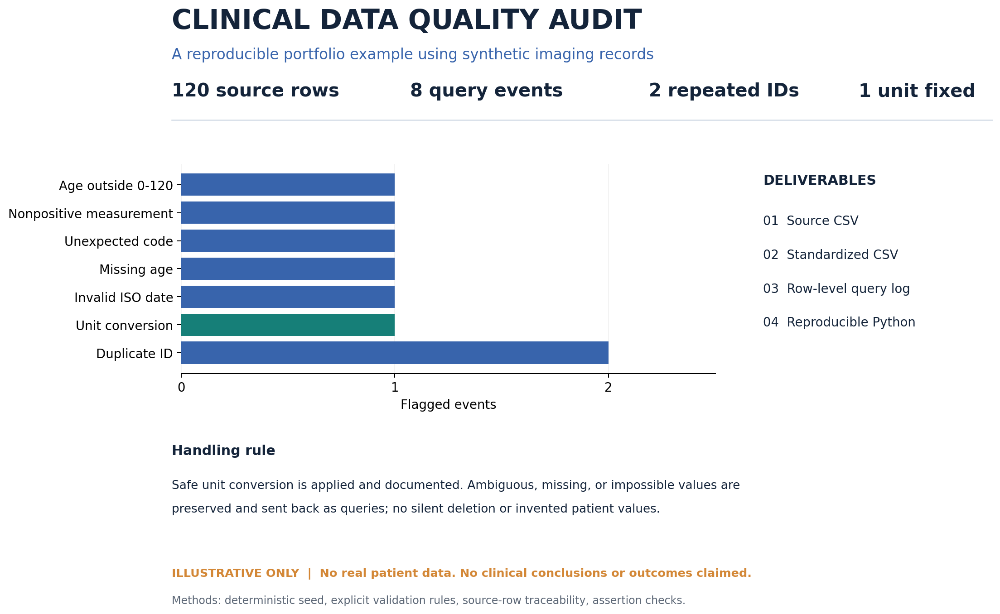

# Clinical imaging data QA — a reproducible synthetic demo

[](https://github.com/chenmei24/clinical-imaging-data-qa-demo/actions/workflows/qa.yml)

**120 synthetic records · 8 documented QA events · 1 defensible unit conversion · 0 silently dropped rows**

This portfolio project shows how a messy clinical-imaging research export can become a **traceable review package**. Every record is fictional (`SYN-*`); this is a self-created demonstration, not a client project, patient dataset, diagnosis, or research result.

Need the same audit for your own authorized, de-identified dataset? [Request a scoped project through Upwork](https://www.upwork.com/freelancers/~0149df5417ad7e0bcf).



## See the difference

| Source row | Before | After | Audit trail |
| --- | --- | --- | --- |
| 81 · `SYN-080` | `lesion_value=2.7`, `lesion_unit=cm` | `lesion_value=27.0`, `lesion_unit=mm` | Conversion logged; source preserved |
| 11 · `SYN-010` | `age_years=155` | **Retained as 155** | Flagged for source-owner verification |
| 120 · `SYN-001` | Repeated record ID | **Both rows retained** | Duplicate flagged; no guessed merge |

The one-page [case study PDF](assets/portfolio_case_study.pdf) and the committed [source](examples/01_synthetic_source.csv), [standardized copy](examples/02_standardized_with_flags.csv), [query log](examples/03_query_log.csv), [change log](examples/04_change_log.csv), and [summary](examples/05_summary.json) let a buyer inspect the actual deliverables.

## What this demo checks

| Check | Example in this dataset | Handling |
| --- | --- | --- |
| Duplicate key | 2 repeated IDs | Retain and query; do not merge |
| Missing / implausible age | Blank, `155` | Retain and query; do not impute |
| Unexpected category | `sex_code=X` | Retain and query against the data dictionary |
| Nonpositive measurement | `lesion_value=-2` | Retain and query |
| Invalid date | `2025/04/31` | Retain and query |
| Unit mismatch | `2.7 cm` among millimetres | Convert to `27.0 mm` and log before/after |

The eight events comprise **seven unresolved queries and one documented conversion**. The checks are demonstration rules for this schema; a real engagement starts by agreeing on the client's data dictionary, valid ranges, units, exclusions, and acceptance criteria.

## Run it

Python 3.10+; **standard library only** for the audit. From the repository root:

```bash
python scripts/audit_csv.py --input examples/01_synthetic_source.csv --output-dir output
python -m unittest discover -s tests -v
```

The command writes `02_standardized_with_flags.csv`, `03_query_log.csv`, `04_change_log.csv`, and `05_summary.json` into `output/`. It never modifies the input file. The tests compare the regenerated deliverables with the committed examples and verify that questionable values remain visible.

On Windows, if you clone this repository under a path containing non-ASCII characters and your Python installation uses a legacy locale, run `python -X utf8` in place of `python`.

For a concise handoff example, see [Sample delivery note](docs/DELIVERY_EXAMPLE.md).

## How a client project differs

1. Review an **authorized, de-identified** sample, column definitions, and intended use.
2. Agree on record keys, valid ranges/codes, units, transformations, and how open queries will be resolved.
3. Deliver a source-preserving cleaned copy, row-level QA log, documented changes, concise summary, and—if scoped—a reusable batch script.
4. Re-run checks after source-owner answers; support a scheduled QA workflow if ongoing maintenance is needed.

This repository demonstrates the method; it is not a universal clinical validation pipeline. If you need a custom data cleaning or automated QA workflow, [contact me through my Upwork profile](https://www.upwork.com/freelancers/~0149df5417ad7e0bcf) with an authorized **de-identified** sample and data dictionary. Do not post patient-identifiable data in a public issue.

## Repository map

```text
assets/      Portfolio preview and one-page PDF
examples/    Synthetic source plus inspectable delivery examples
scripts/     Reusable CSV audit command
tests/       Reproducibility and data-preservation checks
```

No clinical conclusion is inferred from these values. Ambiguous records are left for the authorized source owner to resolve.
